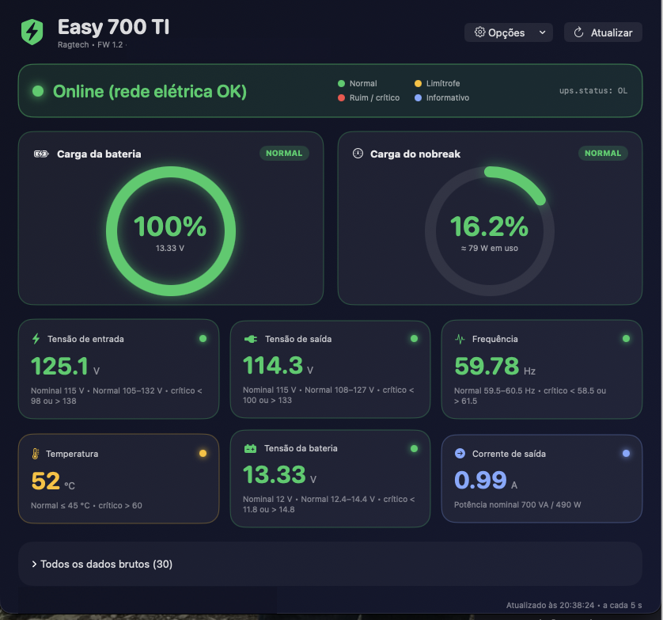
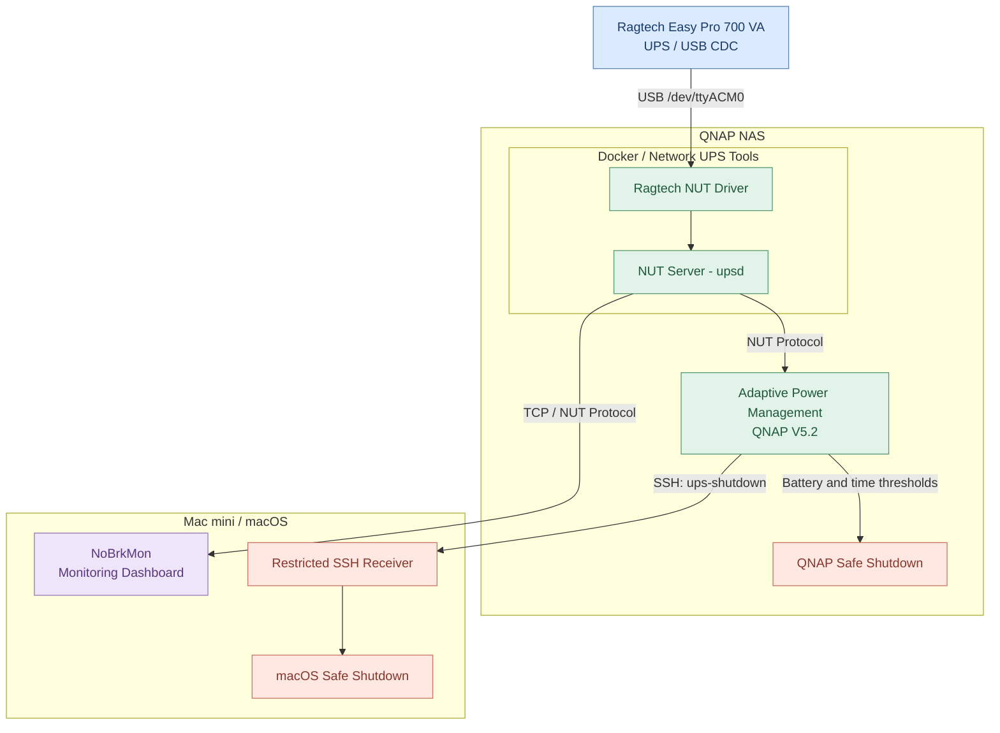

# Ragtech UPS Monitor & Power Management

An open-source project for monitoring Ragtech UPS devices,
integrating Network UPS Tools (NUT), Docker, QNAP NAS systems,
and macOS.

## Features

- Ragtech USB UPS monitoring through NUT
- Docker-based NUT server
- Adaptive battery-based shutdown policy (V5.2)
- Graceful QNAP shutdown
- Remote macOS shutdown via restricted SSH
- Event history and discharge-rate estimation
- NoBrkMon native Swift application for macOS

## NoBrkMon — macOS Monitoring Application

NoBrkMon is a native macOS application for monitoring
Ragtech UPS information through Network UPS Tools (NUT).

## Tested hardware

- UPS: Ragtech Easy Pro 700 VA
- USB: Microchip CDC-ACM, VID 04D8, PID 000A
- NAS: QNAP TS-251D
- macOS: Mac mini M4 Pro

Other models and environments have not yet been validated
by this project.

## Components

## System Architecture

| Directory | Description |
|---|---|
| `docker/` | NUT container build and configuration |
| `driver/` | Driver information and upstream references |
| `scripts/qnap/` | Adaptive shutdown scripts, version V5.2 |
| `scripts/macos/` | Remote shutdown integration |
| `macos/NoBrkMon/` | Native macOS monitoring application |
| `tests/` | Available validation scripts |
| `docs/` | Project documentation |

## NUT version

The Docker build uses the following upstream commit:

1c4ab78c615a7b2b8231bdb023d553abd64b541d

Upstream:
https://github.com/networkupstools/nut

## Getting started

1. Review docker/README.md.
2. Configure your USB device and NUT server.
3. Configure NUT monitoring credentials.
4. Verify UPS readings before enabling shutdown.
5. Configure the QNAP shutdown scripts if required.
6. Configure NoBrkMon using config.example.json.

## Safety

The Ragtech driver is experimental.

Battery percentage is an estimate and does not guarantee
a particular remaining runtime.

Automatic shutdown must be validated for each installation.

Keep NUT access restricted to trusted networks.
Never commit credentials, private SSH keys, or local
configuration files.

## Project status

Pre-release. The driver build has been validated for AMD64.
Independent deployment of the complete Docker/NUT stack
is still pending validation.

## Licenses and acknowledgments

See THIRD_PARTY_NOTICES.md.

## Contributions

Issues, compatibility reports, documentation improvements,
and pull requests are welcome.

## License

Original project components are licensed under MIT,
subject to third-party exceptions.

The Ragtech driver and NUT retain their upstream
licenses, including GPL-2.0-or-later where applicable.

See [Licensing](LICENSES.md) and
[Acknowledgments](ACKNOWLEDGMENTS.md).
